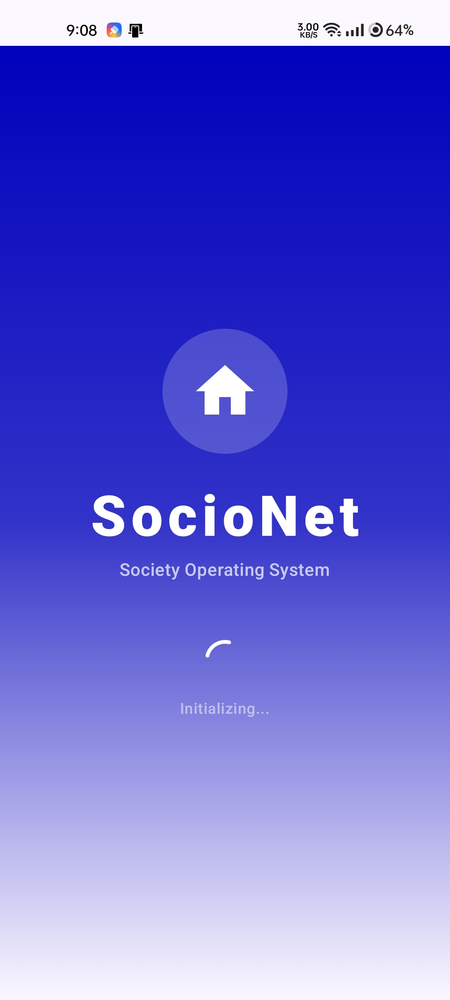
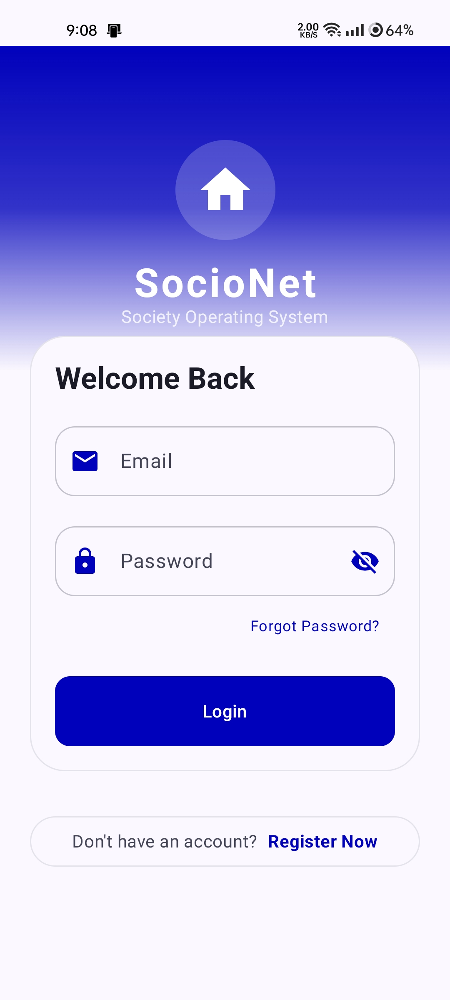
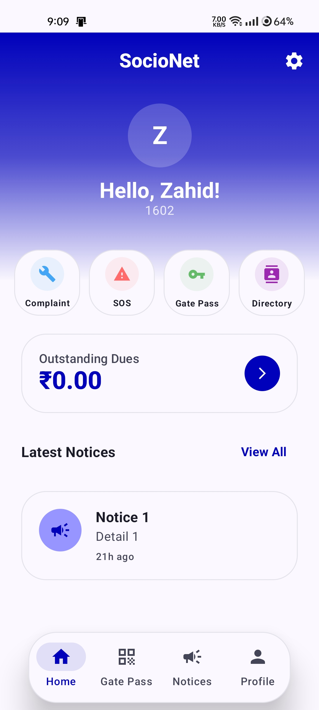
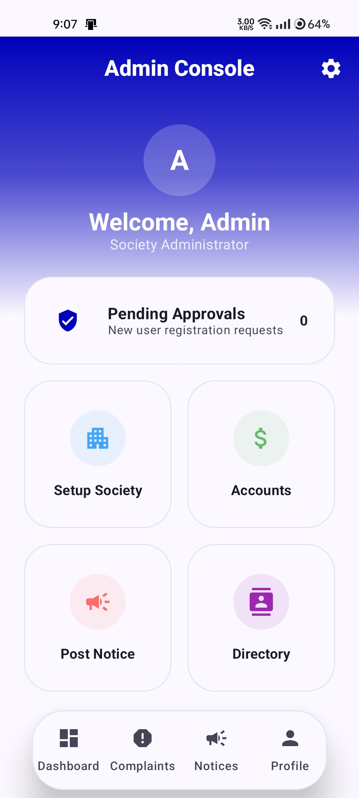
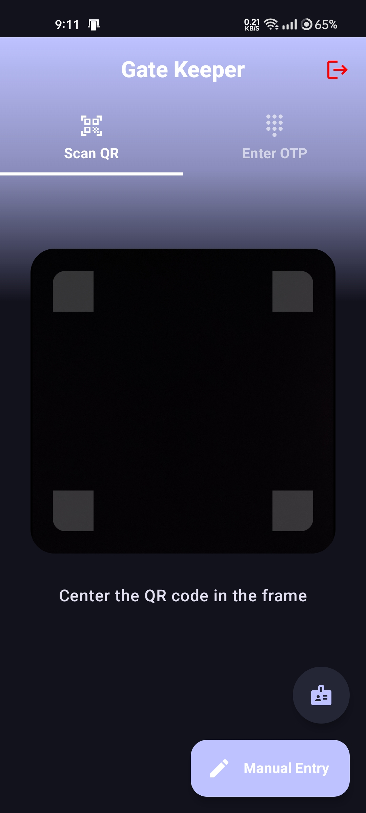

# SocioNet 🏢📱

> A Modern Society Management Application

SocioNet is a production-ready, adaptive mobile solution designed to digitize and streamline residential housing society operations. Developed entirely in Kotlin using modern Jetpack Compose techniques, the application enforces a strict physical hierarchy (Society → Wing → Floor → Flat) to perfectly mirror real-world community dynamics.

By seamlessly handling multi-role users, embracing an offline-first architecture, and providing adaptive interfaces for various devices, SocioNet fosters a connected, transparent, and secure community living environment.

---

## ✨ Key Features by Role

SocioNet is segregated into three distinct environments based on strict Role-Based Access Control (RBAC):

### 🏠 Resident (Owner / Tenant)
*   **Gate Pass & Visitor Management:** Generate pre-approved QR codes for guests or whitelist "Trusted Visitors" for seamless auto-approval at the gate.
*   **Complaints Helpdesk:** Raise and track issues, categorized by type and scope (Personal vs. Community).
*   **Emergency SOS:** Trigger instant emergency alerts that notify the Security Guard device and Society Admin.
*   **Financial Dues:** View outstanding maintenance balances securely.
*   **Staff Tracking:** Link daily helpers (maids, drivers) to specific flats and monitor their real-time gate attendance.

### 👑 Society Admin
*   **Master Data Setup:** Manage the society's physical infrastructure, including Wings, Floors, and Flats.
*   **Identity Verification:** Review, approve, or reject new user sign-up requests to ensure community security.
*   **Staff Registry:** Maintain a centralized database of all society workers.
*   **Digital Notice Board:** Broadcast official notices targeting the entire society, specific wings, or owners only.
*   **Dashboard & Accounts:** Oversee society financials, maintenance collections, and high-level metrics.

### 🛡️ Security Guard
*   **Tablet-Optimized UI:** A specialized, high-contrast interface designed for rapid operation at the society gate.
*   **QR Scanner:** Rapidly scan Resident-generated Gate Passes for instant entry validation.
*   **Manual Entry Logs:** Log unannounced visitors (e.g., cabs, deliveries) and trigger real-time "Approval Requests" directly to the resident's app.
*   **Staff Attendance:** Interface to mark daily check-in/check-out times for registered society staff.
*   **SOS Dashboard:** A high-priority screen to receive and acknowledge emergency alerts from residents.

---

## 📸 Screenshots

<table align="center">
  <tr>
    <td align="center">
       
      <b>Splash Screen</b>
    </td>
    <td align="center">
       
      <b>Login Screen</b>
    </td>
    <td align="center">
       
      <b>Resident Home</b>
    </td>
  </tr>
  <tr>
    <td align="center">
       
      <b>Admin Dashboard</b>
    </td>
    <td align="center">
       
      <b>Security Scanner</b>
    </td>
  </tr>
</table>

---

## 🛠 Tech Stack

| Component            | Technology                                                                |
|:---------------------|:--------------------------------------------------------------------------|
| **Language**         | Kotlin                                                                    |
| **UI Toolkit**       | Jetpack Compose (Declarative UI)                                          |
| **Design System**    | Material 3 (Dynamic colors, modern typography)                            |
| **Architecture**     | MVVM with Clean Architecture principles                                   |
| **Local Storage**    | Room Database (Offline Support / Single Source of Truth)                  |
| **Preferences**      | Jetpack DataStore (Asynchronous preference saving)                        |
| **Cloud Database**   | Firebase Firestore (NoSQL Document Database)                              |
| **Backend Services** | Firebase Authentication, Firebase Cloud Messaging (FCM), Firebase Storage |

---

## 🏗 System Architecture & Design

### Offline-First Caching
To ensure the application functions reliably in poor network zones (such as basements or elevators), SocioNet employs a Network Bound Resource Logic. Critical data is cached locally using Room DB. The application reads from this local cache first, while Firebase silently fetches updates in the background, updating Room and the UI reactively via Kotlin Flow.

### Multi-Role Identity Handling
SocioNet resolves the complex issue of duplicate accounts for users who serve as both committee members and residents. By attaching a roles array to the user profile (e.g., `["admin", "owner"]`), the UI dynamically adapts its Navigation Graph without requiring re-authentication.

### Adaptive Layouts
The UI relies on `WindowSizeClass` to detect device types at runtime. It automatically switches between a standard Bottom Navigation for compact mobile devices and a Navigation Rail or Drawer for expanded tablet displays.

### Hierarchical NoSQL Database
To prevent orphaned accounts, data is stored in a strict relational logic within Firestore:
`Society` → `Wing` → `Flat` → `User`.
Flats act as the anchor collection, linking a primary owner and tenant IDs to a specific physical unit.

---

## 🎓 Academic & Developer Information

*   **Developer:** Kamil Mohd Zahid Mohd Hamid
*   **Institution:** Maharashtra College of Arts Science and Commerce, Mumbai (Affiliated to University of Mumbai)
*   **Degree:** Bachelor of Science (Information Technology)
*   **Academic Year:** 2025 – 2026